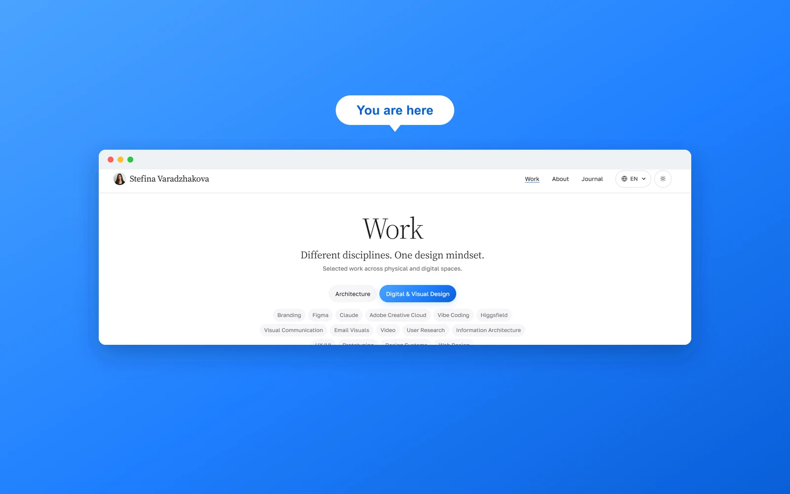

# Stefina Varadzhakova - Portfolio

The portfolio site of a multidisciplinary designer working across architecture, digital products and visual communication. I designed it and built it with Claude.

**Live site:** https://reliable-pasca-8d6b5a.netlify.app



## What's inside

- Selected work in architecture and digital design, with case studies, presentation viewers and image galleries
- A journal for photography, workshops and other side projects
- An About page with experience, education and skills
- English and Bulgarian versions (`/` and `/bg`)
- Light and dark themes, responsive layouts and accessible markup

## Built with

- [Astro](https://astro.build) and TypeScript, as a fully static site
- Plain CSS with design tokens, without a UI framework
- Deployed on [Netlify](https://www.netlify.com)

## Run it locally

Requires Node.js 22.23 or newer.

```
npm install
npm run dev
```

Then open http://localhost:4321. Run `npm run build` to make the production build in `dist/`.

## How the content is organised

All text and project data live in `src/data/`, so the content can change without touching the layout:

| File | What it holds |
|---|---|
| `site.ts` / `site.bg.ts` | Site text, About page, contact details and site switches |
| `projects.ts` | Projects and case studies, with Bulgarian text in each `bg` block |
| `journal.ts` | Journal posts |

Interface labels are in `src/i18n.ts`, and colours and type are at the top of `src/styles/global.css`. Images live in `public/images/`.
